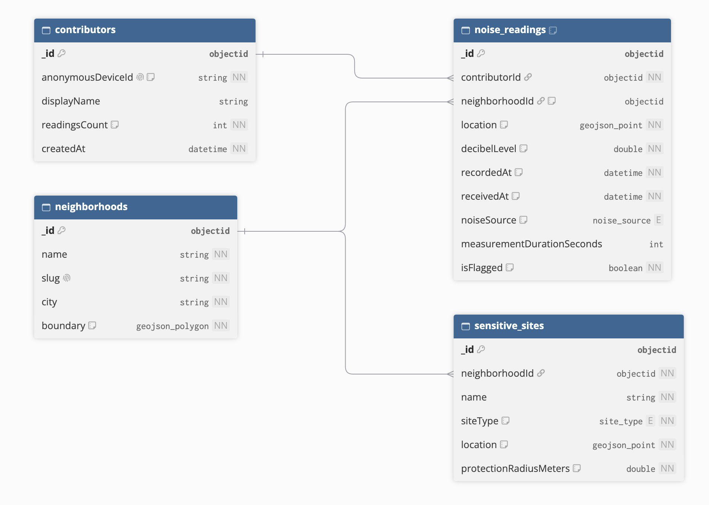

# SoundScape: Initial Database Schema

**Database:** MongoDB (accessed from Fastify)

## 1. Overview

SoundScape stores crowdsourced noise readings and aggregates them per neighborhood for the heatmap. The schema has four collections:

| Collection | Purpose | Expected size |
| :--- | :--- | :--- |
| `noise_readings` | One decibel measurement from one contributor at one place and time. This is the core data. | Large, grows continuously |
| `neighborhoods` | City districts with their geographic boundaries. Readings are grouped by these areas. | Small, mostly static |
| `contributors` | Citizens (or devices) that submit readings. | Medium |
| `sensitive_sites` | Schools, hospitals and similar places that planners want to protect from noise. | Small, mostly static |

## 2. Relationships




All relationships use **references** (an `ObjectId` field), not embedded documents. A neighborhood can collect an unbounded number of readings, and embedding them would break MongoDB's 16 MB document limit.

## 3. Collections

### 3.1 `noise_readings`

| Field | Type | Required | Description |
| :--- | :--- | :--- | :--- |
| `_id` | ObjectId | yes | Generated by MongoDB. |
| `contributorId` | ObjectId → `contributors` | yes | Who submitted the reading. |
| `neighborhoodId` | ObjectId → `neighborhoods` | no | Resolved by the server at insert time from `location`. It is `null` when the point falls outside every known neighborhood. |
| `location` | GeoJSON Point | yes | `{ "type": "Point", "coordinates": [longitude, latitude] }`. Longitude comes first. |
| `decibelLevel` | Double | yes | A-weighted sound level in dB(A). Proposed accepted range: 0–140. |
| `recordedAt` | Date (UTC) | yes | When the measurement was taken on the device. |
| `receivedAt` | Date (UTC) | yes | When the API stored the reading. Set by the server. |
| `noiseSource` | String enum | no | `traffic`, `construction`, `nightlife`, `industry`, `aircraft`, `other`. |
| `measurementDurationSeconds` | Int | no | How long the device sampled before reporting. |
| `isFlagged` | Bool | yes | Default `false`. Set to `true` for suspicious readings so that analytics can exclude them. |

Example document:

```json
{
  "_id": { "$oid": "6718f2a4c1e5b3a9d0f41a27" },
  "contributorId": { "$oid": "6718f1e0c1e5b3a9d0f41a10" },
  "neighborhoodId": { "$oid": "6718f0b2c1e5b3a9d0f41a01" },
  "location": { "type": "Point", "coordinates": [19.9449, 50.0647] },
  "decibelLevel": 72.4,
  "recordedAt": { "$date": "2026-10-23T14:05:00Z" },
  "receivedAt": { "$date": "2026-10-23T14:05:02Z" },
  "noiseSource": "traffic",
  "measurementDurationSeconds": 30,
  "isFlagged": false
}
```

Indexes:

| Index | Supports |
| :--- | :--- |
| `{ location: "2dsphere" }` | Geographic queries, such as readings near a sensitive site. |
| `{ neighborhoodId: 1, recordedAt: 1 }` | `GET /analytics/heatmap`: filter by time range, group by neighborhood. |
| `{ contributorId: 1, recordedAt: -1 }` | A contributor's recent readings and submission rate limits. |

### 3.2 `neighborhoods`

| Field | Type | Required | Description |
| :--- | :--- | :--- | :--- |
| `_id` | ObjectId | yes | Generated by MongoDB. |
| `name` | String | yes | Display name, for example "Stare Miasto". |
| `slug` | String | yes | URL-safe identifier, for example `stare-miasto`. Unique. |
| `city` | String | yes | City the neighborhood belongs to. |
| `boundary` | GeoJSON Polygon or MultiPolygon | yes | District border used to assign readings. |

Indexes: `{ boundary: "2dsphere" }`, `{ slug: 1 }` (unique).

### 3.3 `contributors`

| Field | Type | Required | Description |
| :--- | :--- | :--- | :--- |
| `_id` | ObjectId | yes | Generated by MongoDB. |
| `anonymousDeviceId` | String | yes | Random identifier generated by the client app. Unique. It contains no personal data. |
| `displayName` | String | no | Optional public nickname. |
| `readingsCount` | Int | yes | Incremented on every accepted reading. Default `0`. |
| `createdAt` | Date (UTC) | yes | Registration time. |

Indexes: `{ anonymousDeviceId: 1 }` (unique).

### 3.4 `sensitive_sites`

| Field | Type | Required | Description |
| :--- | :--- | :--- | :--- |
| `_id` | ObjectId | yes | Generated by MongoDB. |
| `neighborhoodId` | ObjectId → `neighborhoods` | yes | Neighborhood that contains the site. |
| `name` | String | yes | For example "Szpital Uniwersytecki". |
| `siteType` | String enum | yes | `school`, `hospital`, `kindergarten`, `care_home`. |
| `location` | GeoJSON Point | yes | Site position. |
| `protectionRadiusMeters` | Double | yes | Area around the site that planners monitor. Default `200`. |

Indexes: `{ location: "2dsphere" }`.
